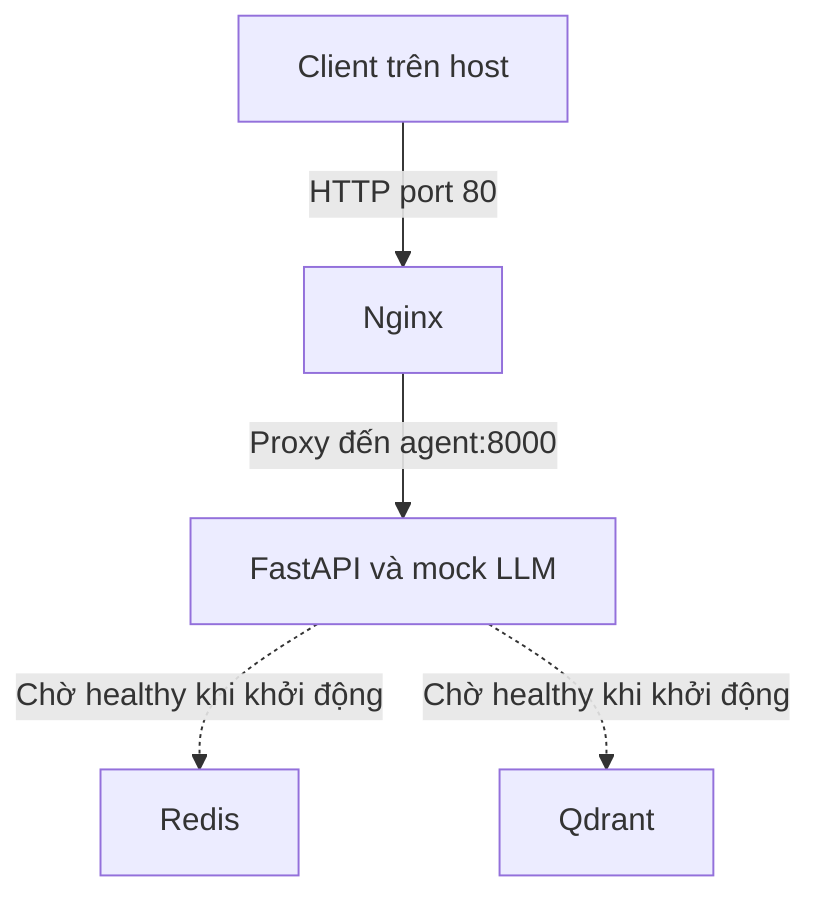
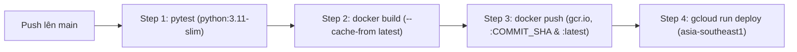
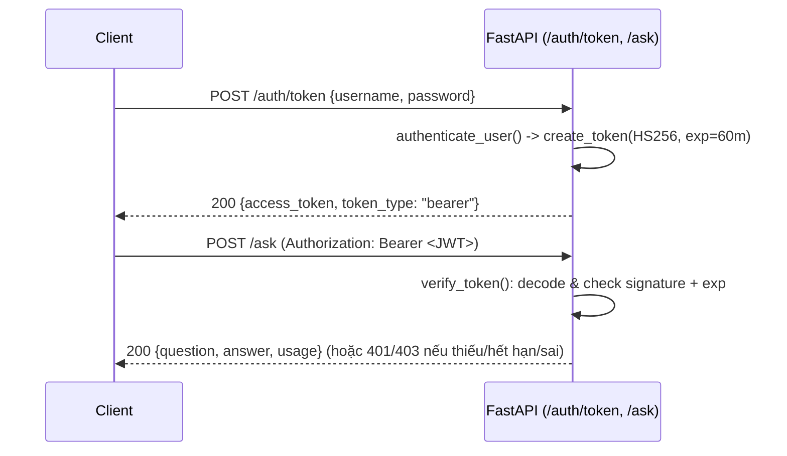
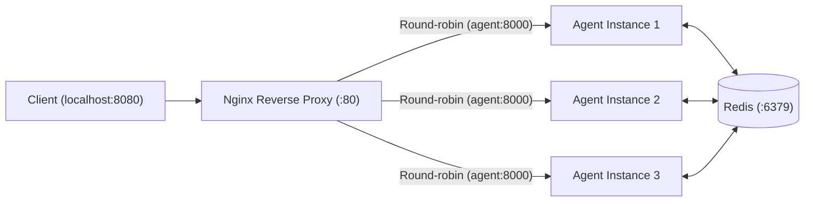

# Day 14 Lab — Mission Answers

## Part 1 — Localhost vs Production

### Exercise 1.1 — Anti-patterns trong bản basic

| Quan sát trong `develop/app.py` | Hệ quả khi triển khai |
|---|---|
| API key và chuỗi kết nối DB có thông tin đăng nhập được viết trực tiếp trong code | Secret thật sẽ đi theo Git history, bản sao repo và artifact. Nếu đã lộ, cần thu hồi và cấp lại. Các giá trị trong bài lab là dữ liệu minh họa. |
| `print()` ghi key, nội dung câu hỏi và câu trả lời | Nội dung nhạy cảm có thể xuất hiện trong log tập trung. |
| Chỉ bind `localhost` | Request từ ngoài container hoặc từ reverse proxy sẽ không đến được listener. |
| Port cố định `8000` | Không thể đổi port theo môi trường mà không sửa code. |
| Luôn bật `reload=True` | File watcher và việc restart khi source thay đổi phù hợp với vòng lặp phát triển local. |
| Thiếu `GET /health` và `GET /ready` | Hệ thống triển khai thiếu tín hiệu riêng để xác định process còn phục vụ được và instance có thể nhận traffic. |
| Thiếu lifecycle riêng để khởi tạo và giải phóng tài nguyên | Khi thêm model client hoặc DB connection, app chưa có chỗ gắn startup và cleanup. Uvicorn vẫn có lifecycle mặc định. |

### Exercise 1.2 — Chạy và gọi bản basic

Từ repo root trên PowerShell, tạo môi trường và chạy bản basic. Dùng một terminal khác để gửi HTTP request.

```powershell
python -m venv .venv
.\.venv\Scripts\python.exe -m pip install -r .\01-localhost-vs-production\production\requirements.txt
Set-Location .\01-localhost-vs-production\develop
..\..\.venv\Scripts\python.exe app.py
```

```powershell
curl.exe -i -X POST 'http://localhost:8000/ask?question=Hello'
curl.exe -i 'http://localhost:8000/health'
```

Tiêu chí đạt là `POST /ask?question=Hello` trả `200` với trường `answer` và `GET /health` trả `404`. Trong bản basic, FastAPI đọc `question` từ **query string**. Gửi riêng JSON body cho route này sẽ nhận `422`. Nội dung `answer` có thể thay đổi giữa các lượt vì mock LLM chọn ngẫu nhiên trong nhóm câu trả lời mặc định.

### Exercise 1.3 — So sánh hai bản

| Hạng mục | Basic | Advanced | Lý do |
|---|---|---|---|
| Config | Host, port và reload đặt trong code | Đọc environment variables. `.env` cung cấp cấu hình local và được nạp trước khi tạo `Settings`. | Chạy cùng source ở nhiều môi trường. Biến từ shell hoặc platform được ưu tiên để có thể override cấu hình local. |
| Secrets | Giá trị minh họa nằm trong source và key bị ghi ra log | Key đọc từ env. App chỉ log metadata như độ dài câu hỏi. | Giảm nguy cơ đưa secret hoặc dữ liệu người dùng vào source và log. |
| Probes | Thiếu cả hai endpoint | `/health` báo liveness. `/ready` dựa trên cờ readiness của app. | Hệ thống có thể dùng liveness để giám sát process và readiness để quyết định chuyển traffic. |
| Logging | Chuỗi `print()` | Mỗi log app là một JSON object với `event` và các trường metadata riêng. | Có thể parse, lọc theo event và kiểm tra thứ tự lifecycle. |
| Shutdown | Lifecycle mặc định của Uvicorn | Uvicorn chờ request đang xử lý. FastAPI chạy cleanup trong `lifespan`. | Tài nguyên thuộc về app được dọn sau khi request in flight kết thúc trong thời gian chờ shutdown. |

Mock LLM hiện dùng `time.sleep()` để mô phỏng thời gian chờ. Bản advanced chạy lời gọi đồng bộ đó trong thread pool để event loop vẫn có thể xử lý `/health` trong lúc chờ câu trả lời. Cờ `/ready` ở Checkpoint 1 chỉ mô phỏng vòng đời startup và shutdown. Bài lab triển khai kiểm tra dependency như Redis ở các phần sau.

### Tự đánh giá bản advanced

Dừng bản basic. Từ repo root trong một terminal PowerShell mới, tạo `.env` nếu chưa có và đổi port bằng biến của shell.

```powershell
Set-Location .\01-localhost-vs-production\production
if (-not (Test-Path .env)) { Copy-Item .env.example .env }
$env:PORT = '8001'
$env:ENVIRONMENT = 'checkpoint1'
..\..\.venv\Scripts\python.exe app.py
```

Trong terminal thứ hai:

```powershell
Invoke-RestMethod 'http://127.0.0.1:8001/health'
Invoke-RestMethod 'http://127.0.0.1:8001/ready'
Invoke-RestMethod 'http://127.0.0.1:8001/ask' -Method Post `
  -ContentType 'application/json' -Body (@{ question = 'Hello' } | ConvertTo-Json)
```

| Bạn muốn kiểm tra | Bằng chứng cần thấy |
|---|---|
| Env thực sự đổi hành vi | App nghe trên `8001` và `/health` trả `environment=checkpoint1`. Thử thêm `APP_NAME=Agent Checkpoint 1` trong `.env`, restart rồi xem `GET /`. Đặt tiếp `$env:APP_NAME` sang giá trị khác, restart và xác nhận giá trị từ shell được ưu tiên. |
| Liveness và readiness | Sau startup, `/health` và `/ready` đều trả `200`. Trong một bài test có kiểm soát, đặt cờ readiness thành false khi app còn chạy và kỳ vọng `/ready=503`, `/health=200`. |
| Log thực sự là JSON | Copy một dòng log app bắt đầu bằng `{` rồi pipe vào `ConvertFrom-Json`. Event `agent_request` có `question_length` và event `agent_response` có `response_length`. Kiểm tra log không chứa nguyên văn câu hỏi hoặc key. |
| Shutdown có cleanup | Nhấn **Ctrl+C** trong terminal chạy advanced và quan sát event `shutdown_complete`. Để xác minh drain, dùng request đủ dài, gửi tín hiệu dừng **sau** khi request vào handler, rồi kiểm tra HTTP `200` và thứ tự `agent_response` → `shutdown_complete`. Mock mặc định trả quá nhanh để dùng thao tác tay làm bằng chứng đáng tin cậy. |

#### Kiểm tra graceful shutdown khi đang có request

Trong Linux hoặc WSL, mở thư mục `01-localhost-vs-production/production` trong terminal đã cài dependencies. Lệnh dưới đây chỉ kéo dài mock LLM cho tiến trình thử nghiệm, không cần sửa source.

```bash
log_path=$(mktemp)
python -u -c 'from functools import partial; import app, uvicorn; app.ask = partial(app.ask, delay=3); uvicorn.run(app.app, host="127.0.0.1", port=8001)' > "$log_path" 2>&1 &
server_pid=$!
curl -fsS --retry 5 --retry-connrefused http://127.0.0.1:8001/health
curl -fsS -w '\nHTTP %{http_code}\n' http://127.0.0.1:8001/ask \
  -H 'Content-Type: application/json' -d '{"question":"Hello"}' &
request_pid=$!
for attempt in {1..30}; do
  grep -q '"event": "agent_request"' "$log_path" && break
  sleep 0.1
done
if grep -q '"event": "agent_request"' "$log_path"; then
  kill -TERM "$server_pid"
else
  echo 'Chưa thấy request vào handler. Kiểm tra log startup và port.'
  kill -TERM "$server_pid" 2>/dev/null
fi
wait "$request_pid"
wait "$server_pid"
grep -E '"event": "(agent_request|agent_response|shutdown_complete)"' "$log_path"
```

Đạt nếu request trả `HTTP 200` và ba event xuất hiện theo thứ tự trên. Chỉ có `shutdown_complete` thì mới chứng minh được cleanup đã chạy, chưa đủ để kết luận request đang xử lý đã được hoàn tất.

### Kết quả kiểm chứng

- Basic, kiểm tra trực tiếp qua ASGI. Query `POST /ask` trả `200`, gửi JSON body nhận `422`, và `GET /health` trả `404`.
- Advanced, kiểm tra trực tiếp qua ASGI. `POST /ask` với JSON trả `200`. `/health` trả `200` và phản ánh `ENVIRONMENT`. `/ready` trả `503 → 200 → 503` trước, trong và sau app lifespan.
- Config đọc được file `.env`, ưu tiên process env và báo lỗi khi thiếu `AGENT_API_KEY` trong môi trường `production`. Năm dòng log app trong bài test parse được thành JSON, gồm `shutdown_complete`. Nội dung câu hỏi thử nghiệm không xuất hiện trong log.
- Lượt kiểm tra dùng FastAPI `0.165.0`, Uvicorn `0.54.0` và python-dotenv `1.2.4` sẵn có. Phiên này không kết nối được tới PyPI để cài phiên bản đã pin và không chạy được listener loopback để kiểm tra `SIGTERM` end-to-end. Dùng bài thử Linux/WSL ở trên để xác nhận request đang xử lý thực sự hoàn tất khi server nhận tín hiệu dừng.

### Checkpoint 1

- [x] Giải thích rủi ro của hardcoded secrets trong Git history và log.
- [x] Đổi cấu hình qua env và kiểm tra mức ưu tiên giữa shell và `.env`.
- [x] Phân biệt liveness với readiness qua status code.
- [x] Phân biệt drain request của Uvicorn với cleanup tài nguyên trong FastAPI lifespan.

## Part 2 — Docker Containerization

### Exercise 2.1 — Đọc Dockerfile basic

| Câu hỏi | Trả lời | Vì sao quan trọng |
|---|---|---|
| Base image nào? | `FROM python:3.11` | Cố định dòng Python 3.11 cho môi trường trong container và dùng bản Python đầy đủ cho ví dụ single-stage. |
| Working directory nào? | `WORKDIR /app` | Các lệnh tiếp theo dùng `/app` làm thư mục làm việc. `COPY ... .` đặt file vào đây và `python app.py` chạy từ đây. |
| Vì sao copy `requirements.txt` trước source? | Bước cài dependencies đứng trước bước copy code. | Khi chỉ sửa `app.py`, Docker có thể dùng lại layer cài dependencies. Đổi `requirements.txt` sẽ buộc Docker đánh giá lại bước cài. `pip --no-cache-dir` tắt cache của pip, còn Docker vẫn có layer cache riêng. |
| `CMD` khác `ENTRYPOINT` thế nào? | `ENTRYPOINT` xác định chương trình chính. `CMD` chỉ định lệnh mặc định khi không có entrypoint riêng, hoặc tham số mặc định cho exec-form entrypoint. | Ở Dockerfile này, lệnh mặc định là `CMD ["python", "app.py"]`. Ví dụ `docker run --rm my-agent:develop python --version` thay lệnh mặc định cho một lần chạy. |

`EXPOSE 8000` mô tả port của app trong image. `-p 8000:8000` khi chạy container mới publish port đó ra máy host. Cả hai Dockerfile Python dùng đường dẫn `COPY` tính từ **repo root**, nên chọn Dockerfile với `-f` và để dấu `.` cuối lệnh trỏ vào repo root.

### Exercise 2.2 — Build và chạy basic

Chạy các lệnh PowerShell từ repo root, khi Docker Desktop đang chạy Linux engine.

```powershell
docker build -f 02-docker/develop/Dockerfile -t my-agent:develop .
docker run --rm -d --name day14-cp2-basic -p 127.0.0.1:8000:8000 my-agent:develop
curl.exe --fail-with-body -i http://127.0.0.1:8000/health
curl.exe --fail-with-body -i -X POST 'http://127.0.0.1:8000/ask?question=What%20is%20Docker%3F'
docker logs --tail 30 day14-cp2-basic
docker exec day14-cp2-basic python --version
docker stop day14-cp2-basic
```

Tiêu chí đạt là `/health` trả `200` với `status=ok`, `POST /ask` trả `200` với trường `answer`, và `docker exec` in phiên bản Python trong container. Basic nhận `question` qua query string. Trong `CODE_LAB.md` đã sửa lệnh từng gửi JSON vào route này.

### Exercise 2.3 — Build multi-stage và đo kích thước

| Stage | Làm gì | Quyết định trong `02-docker/production/Dockerfile` |
|---|---|---|
| `builder` | Cài build tools và dependencies vào `/opt/venv`. | Dùng đường dẫn venv cố định. Kết quả cài đặt có thể được copy nguyên vẹn qua stage sau. |
| `runtime` | Bắt đầu lại từ `python:3.11-slim`, nhận venv và source, chạy Uvicorn bằng `appuser`. | Giữ venv đúng đường dẫn và đưa `/opt/venv/bin` lên `PATH`. Python và Uvicorn dùng cùng bộ dependencies dưới user non-root. |

Image advanced có hai nguồn giảm kích thước kỳ vọng. Base runtime là `slim` và các layer cài compiler/build headers chỉ nằm trong builder. Hai yếu tố cùng thay đổi giữa basic và advanced, nên chênh lệch đo được phản ánh cả hai.

```powershell
docker build -f 02-docker/production/Dockerfile -t my-agent:advanced .
docker run --rm my-agent:advanced id
docker run --rm my-agent:advanced python -c 'import fastapi, uvicorn; print(fastapi.__version__)'
$basicBytes = [long](docker image inspect my-agent:develop --format '{{.Size}}')
$advancedBytes = [long](docker image inspect my-agent:advanced --format '{{.Size}}')
[pscustomobject]@{
    BasicMB = [math]::Round($basicBytes / 1e6, 1)
    AdvancedMB = [math]::Round($advancedBytes / 1e6, 1)
    ReductionPercent = [math]::Round(100 * (1 - $advancedBytes / $basicBytes), 1)
}
```

Kiểm tra `id` cho thấy UID khác 0 và Python import được dependencies. Chỉ tính tỷ lệ giảm sau khi đã build thành công cả hai image trên cùng Docker engine.

**Kết quả đo thực tế (Docker Engine `29.9.3`):**

- Develop (`02-docker/develop/Dockerfile`, tag `my-agent:develop`): `1667.8 MB` (`1,667,780,268 bytes`)
- Production (`02-docker/production/Dockerfile`, stage `runtime`): `276.9 MB` (`276,883,615 bytes`, đạt mục tiêu `< 500 MB`)
- Tỷ lệ giảm: **`83.4%`**
- Non-root user trong runtime: `uid=999(appuser) gid=999(appuser) groups=999(appuser)`

### Exercise 2.4 — Compose, luồng request và debug



Compose tạo bốn service trên cùng bridge network. Client gọi port 80 của host, Nginx chuyển request qua DNS nội bộ đến `agent:8000`. Redis và Qdrant có named volume riêng. Hai đường nét đứt thể hiện điều kiện startup. Handler `/ask` trong bài này gọi mock LLM, còn Redis và Qdrant là các dependency được khai báo sẵn để minh họa Compose.

Trong `docker-compose.yml`, mình chuyển `.env.local` sang tùy chọn để checkout mới chạy được với cấu hình mặc định. Nginx chờ `agent` healthy trước khi start. Compose chỉ publish cổng HTTP đang được Nginx lắng nghe. Healthcheck cung cấp trạng thái health cho Docker và điều kiện khởi động cho Compose. Bản thân healthcheck không khởi động lại một container vẫn đang chạy.

```powershell
$composeFile = '02-docker/production/docker-compose.yml'
docker compose -f $composeFile config --quiet
docker compose -f $composeFile up --build -d
docker compose -f $composeFile ps
Invoke-RestMethod 'http://localhost/health'
$payload = @{ question = 'Explain microservices' } | ConvertTo-Json
Invoke-RestMethod 'http://localhost/ask' -Method Post -ContentType 'application/json' -Body $payload

docker compose -f $composeFile logs --tail 30 agent nginx
docker compose -f $composeFile exec nginx nginx -t
docker compose -f $composeFile exec agent python -c 'import urllib.request; print(urllib.request.urlopen("http://127.0.0.1:8000/health").status)'
docker compose -f $composeFile exec redis redis-cli ping
docker compose -f $composeFile down
```

| Dấu hiệu | Kiểm tra |
|---|---|
| Compose đứng ở bước startup | Xem `ps` và `logs` của service chưa healthy. Agent chờ Redis và Qdrant, Nginx chờ agent. |
| HTTP qua Nginx lỗi | So sánh `/health` qua host với probe chạy bên trong agent. Nếu probe nội bộ trả `200`, xem log Nginx và chạy `nginx -t` để kiểm tra proxy. |
| `/ask` trả `422` | Đối chiếu request contract. Basic dùng query string và advanced qua Nginx dùng JSON body. |
| Cần kiểm tra quá trình chạy | `docker logs` đọc stdout/stderr. `docker exec` chạy lệnh trong container đang chạy để kiểm tra Python, quyền user hoặc kết nối mạng. Với Compose, dùng tên service qua `docker compose logs` và `exec`. |

### Checkpoint 2 — Kết quả kiểm chứng

| Yêu cầu | Trạng thái |
|---|---|
| Hiểu cấu trúc Dockerfile | Đã giải thích các lệnh, build context, layer cache và cách override `CMD`. Đã build và chạy thực tế `my-agent:develop` (`/health` trả `200`, `POST /ask?question=Docker` trả `200`, `docker exec` ra `Python 3.11.18`). |
| Hiểu multi-stage build | Đã sửa cách chuyển `/opt/venv` sang stage `runtime` chạy bằng non-root `appuser` (`uid=999`). Đo thực tế giảm **83.4%** kích thước image (`1667.8 MB` → `276.9 MB`, đạt `< 500 MB`). |
| Hiểu Compose orchestration | `docker compose config --quiet` đạt dù thiếu `.env.local`. Chạy thực tế `docker compose up --build --wait` lên đủ 4 service (`redis`, `qdrant`, `agent` đều `healthy`, `nginx` lắng nghe port 80); `GET http://127.0.0.1/health` và `POST http://127.0.0.1/ask` qua Nginx đều trả `200`. |
| Biết debug container | Đã chạy thực tế trên container: `docker logs`, `docker exec ... python --version` (`Python 3.11.18`), `docker compose exec -T nginx nginx -t` (`syntax is ok`, `test is successful`), `docker compose exec -T redis redis-cli ping` (`PONG`), `docker compose exec -T agent id` (`uid=999(appuser)`), và `docker compose logs agent nginx` (ghi nhận JSON log của agent và access log của Nginx). |

Toàn bộ các bước kiểm chứng Exercise 2.2–2.4 đã chạy thành công trên Docker Engine `29.9.3` thông qua script `02-docker/verify-checkpoint2.ps1` (và dọn dẹp container/volume sau khi chạy).

### Checkpoint 2

- [x] Hiểu cấu trúc Dockerfile
- [x] Biết lợi ích của multi-stage builds
- [x] Hiểu Docker Compose orchestration
- [x] Biết cách debug container (`docker logs`, `docker exec`)

## Part 3 — Cloud Deployment

### Exercise 3.1 — Deploy lên Railway

Ứng dụng mẫu ở `03-cloud-deployment/railway/app.py` đọc `PORT` từ biến môi trường (`os.getenv("PORT", 8000)`), mở `GET /`, `GET /health` và `POST /ask` (nhận JSON `{"question": "..."}`; nếu `question` rỗng sẽ trả `422`). File `03-cloud-deployment/railway/railway.toml` cấu hình build bằng `NIXPACKS`, start bằng `uvicorn app:app --host 0.0.0.0 --port $PORT`, health check tại `/health` (timeout 30s) và tự restart tối đa 3 lần khi lỗi (`ON_FAILURE`).

**Quy trình deploy từ PowerShell (từ repo root):**

```powershell
Set-Location .\03-cloud-deployment\railway
npm i -g @railway/cli
railway login
railway init
railway variables set ENVIRONMENT=production AGENT_API_KEY=my-secret-key
railway up
railway domain
```

> Lưu ý: Không cần set thủ công `PORT` nếu để Railway tự cấp phát — Railway tự inject biến `$PORT` vào runtime.

**Kiểm tra public URL và xem logs sau khi deploy:**

```powershell
$url = "https://<your-railway-domain>.up.railway.app"
Invoke-RestMethod "$url/health"
Invoke-RestMethod "$url/ask" -Method Post -ContentType 'application/json' `
  -Body (@{ question = 'Hello from Railway' } | ConvertTo-Json)
railway logs
```

> Lưu ý về `CODE_LAB.md`: lệnh mẫu trong `CODE_LAB.md` gửi `{"question": ""}` sẽ nhận HTTP `422` do `app.py` kiểm tra bắt buộc `question` không rỗng. Cần truyền câu hỏi hợp lệ để kiểm tra HTTP `200`.

**Thông tin deploy thực tế:**

- Platform: **Render** (Web Service, Root Directory `03-cloud-deployment/railway`, Region Singapore, gói Free)
- Public URL: `https://day14-ai-agent.onrender.com`
- Environment Variables đã cấu hình trên Render: `PYTHON_VERSION=3.11.0`, `ENVIRONMENT=production`, `AGENT_API_KEY` (secret tự đặt)
- Kết quả kiểm chứng thực tế:
  - `GET https://day14-ai-agent.onrender.com/health` → `200 OK` (`status=ok`, `uptime_seconds=164.9`, `timestamp=2026-11-25T09:00:45.474624+00:00`)
  - `POST https://day14-ai-agent.onrender.com/ask` với `{"question": "Hello from Render"}` → `200 OK`, trả về `question` và `answer` từ mock LLM (trường `platform` trả `"Railway"` do code mẫu `03-cloud-deployment/railway/app.py` hardcode chuỗi này)
- Screenshot: *(tùy chọn — nếu nộp bài theo `DAY14_DELIVERY_CHECKLIST.md`, lưu ảnh Render Dashboard vào `screenshots/` và gắn link tại đây)*

### Exercise 3.2 — So sánh `render.yaml` và `railway.toml`

| Tiêu chí | `railway.toml` (`03-cloud-deployment/railway/railway.toml`) | `render.yaml` (`03-cloud-deployment/render/render.yaml`) |
|---|---|---|
| Định dạng & phạm vi | TOML — cấu hình build & deploy cho **1 service** hiện tại. | YAML (Blueprint IaC) — khai báo **nhiều resource** cùng lúc trong 1 file (`web` service + `redis` add-on). |
| Builder / Runtime | `builder = "NIXPACKS"` (tự detect Python hoặc Dockerfile). | Khai báo tường minh `runtime: python`, `region: singapore`, `plan: free`, `buildCommand`. |
| Start command | `startCommand = "uvicorn app:app --host 0.0.0.0 --port $PORT"` | `startCommand: uvicorn app:app --host 0.0.0.0 --port $PORT` |
| Health check | `healthcheckPath = "/health"`, `healthcheckTimeout = 30`. | `healthCheckPath: /health`. |
| Restart & Auto-deploy | Cấu hình `restartPolicyType = "ON_FAILURE"`, `restartPolicyMaxRetries = 3`. | Bật `autoDeploy: true` (tự deploy khi push GitHub). |
| Environment variables & Secrets | Không khai báo trong `railway.toml`; đặt riêng qua Railway Dashboard hoặc `railway variables set`. | Khai báo trực tiếp trong `envVars`: giá trị thường (`ENVIRONMENT`, `PYTHON_VERSION`), secret nhập tay trên Dashboard (`sync: false` cho `OPENAI_API_KEY`), hoặc tự sinh ngẫu nhiên (`generateValue: true` cho `AGENT_API_KEY`). |
| Persistent Disk & Services kèm theo | Quản lý qua Dashboard/CLI. | Hỗ trợ khai báo ngay trong YAML (`disk`, `type: redis` với `maxmemoryPolicy: allkeys-lru`). |

> Lưu ý khi deploy Render từ repo này: `03-cloud-deployment/render/` chỉ chứa `render.yaml`, còn `app.py` và `requirements.txt` nằm ở `03-cloud-deployment/railway/`. Nếu dùng Render Blueprint, cần thêm `rootDir: 03-cloud-deployment/railway` cho web service hoặc dùng `06-lab-complete/render.yaml` ở phần tổng hợp.

### Exercise 3.3 (Optional) — Phân tích GCP Cloud Run (`cloudbuild.yaml` và `service.yaml`)



- **`cloudbuild.yaml` (CI/CD Pipeline):**
  - Chạy tuần tự 4 bước có phụ thuộc (`waitFor`): `test` (cài deps và chạy `pytest`) → `build` (build Docker image, gắn 2 tag `$COMMIT_SHA` và `latest`, tận dụng `--cache-from`) → `push` (đẩy image lên Container Registry) → `deploy` (triển khai lên Cloud Run tại `asia-southeast1` với `--min-instances=1`, `--max-instances=10`, `512Mi` RAM, `1` CPU, timeout `60s`, gắn secret từ Secret Manager qua `--set-secrets`).
  - Dùng `logging: CLOUD_LOGGING_ONLY`, `machineType: E2_MEDIUM`, timeout tổng `1200s`.
- **`service.yaml` (Cloud Run Service IaC — Knative `v1`):**
  - **Scaling & Cold start:** `minScale: "1"` giữ tối thiểu 1 instance luôn nóng để tránh cold start cho AI agent; `maxScale: "10"` giới hạn chi phí; `containerConcurrency: 80` cho phép mỗi instance phục vụ tối đa 80 request đồng thời.
  - **Tài nguyên:** `requests` (`0.5` CPU / `256Mi`) và `limits` (`1` CPU / `512Mi`), `timeoutSeconds: 60`.
  - **Secrets an toàn:** `OPENAI_API_KEY` và `AGENT_API_KEY` tham chiếu qua `secretKeyRef` từ Secret Manager thay vì hardcode.
  - **Probes tách biệt:** `startupProbe` gọi `/ready` khi khởi động (`initialDelaySeconds: 5`, `periodSeconds: 3`, `failureThreshold: 10`), còn `livenessProbe` gọi `/health` định kỳ mỗi `30s`.

### Quản lý biến môi trường & xem logs trên Cloud

| Platform | Set Environment Variables | Xem Logs |
|---|---|---|
| **Railway** | Dashboard → *Variables* hoặc CLI `railway variables set KEY=VALUE` | Dashboard → *Deployments / Logs* hoặc CLI `railway logs` |
| **Render** | Dashboard → *Environment* (hoặc `envVars` trong `render.yaml` với `sync: false` cho secret) | Dashboard → Service → *Logs* (live stream) |
| **GCP Cloud Run** | `--set-env-vars` / `--set-secrets` (Secret Manager) hoặc mục `env` trong `service.yaml` | Cloud Logging (`gcloud run services logs read ai-agent --region=asia-southeast1`) |

### Checkpoint 3 — Kết quả kiểm chứng

| Yêu cầu | Trạng thái |
|---|---|
| Deploy thành công lên ít nhất 1 platform | Đã deploy thành công lên **Render** từ GitHub (`main`, `rootDir: 03-cloud-deployment/railway`). |
| Có public URL hoạt động | `https://day14-ai-agent.onrender.com` đang hoạt động: `GET /health` trả `200 OK` (`status=ok`), `POST /ask` trả `200 OK` kèm câu trả lời. |
| Hiểu cách set environment variables trên cloud | Đã cấu hình `PYTHON_VERSION`, `ENVIRONMENT`, `AGENT_API_KEY` trên Render Dashboard và phân tích cách quản lý env vars/secrets trên Railway, Render (`sync: false`, `generateValue: true`) và Cloud Run (`secretKeyRef`). |
| Biết cách xem logs | Đã theo dõi quá trình build/startup và runtime logs trên Render Dashboard, đồng thời nắm lệnh CLI tương ứng (`railway logs`, `gcloud run services logs read`). |

### Checkpoint 3

- [x] Deploy thành công lên ít nhất 1 platform
- [x] Có public URL hoạt động
- [x] Hiểu cách set environment variables trên cloud
- [x] Biết cách xem logs

## Part 4 — API Security

### Exercise 4.1 — API Key Authentication (`04-api-gateway/develop/app.py`)

| Câu hỏi | Trả lời |
|---|---|
| API key được check ở đâu? | Trong FastAPI dependency `verify_api_key(api_key: str = Security(api_key_header))` đọc header `X-API-Key` (`APIKeyHeader(name="X-API-Key", auto_error=False)`), gắn vào `POST /ask` qua `Depends(verify_api_key)`. Hai route `GET /` và `GET /health` để public để platform probe được. |
| Điều gì xảy ra nếu thiếu / sai key? | Thiếu header `X-API-Key` trả HTTP **`401 Unauthorized`** (`Missing API key. Include header: X-API-Key: <your-key>`); gửi sai key trả HTTP **`403 Forbidden`** (`Invalid API key.`). |
| Làm sao rotate key không downtime? | Dùng cơ chế **dual-key**: (1) nạp đồng thời cả key cũ và key mới qua env (ví dụ `AGENT_API_KEYS=old_key,new_key` và kiểm tra membership), (2) chuyển toàn bộ client sang key mới, (3) xác nhận qua log không còn request dùng key cũ, (4) gỡ key cũ khỏi env/secret store và reload service. Trong production nên dùng `hmac.compare_digest()` để tránh timing attack và bỏ `print(f"API Key: {API_KEY}")` khỏi startup. |

**Lệnh test nhanh (PowerShell, chạy từ `04-api-gateway/develop`):**

```powershell
$env:AGENT_API_KEY = "secret-key-123"
python app.py
```

```powershell
# Không có key -> 401
curl.exe -i -X POST http://127.0.0.1:8000/ask -H "Content-Type: application/json" -d '{"question":"Hello"}'
# Sai key -> 403
curl.exe -i -X POST http://127.0.0.1:8000/ask -H "X-API-Key: wrong-key" -H "Content-Type: application/json" -d '{"question":"Hello"}'
# Đúng key -> 200
curl.exe -i -X POST http://127.0.0.1:8000/ask -H "X-API-Key: secret-key-123" -H "Content-Type: application/json" -d '{"question":"Hello"}'
```

> Lưu ý: `04-api-gateway/develop/app.py` dùng key mặc định `demo-key-change-in-production` nếu không đặt `AGENT_API_KEY`, nên cần set `$env:AGENT_API_KEY = "secret-key-123"` trước khi test với key trong `CODE_LAB.md`.

### Exercise 4.2 — JWT Authentication (`04-api-gateway/production/auth.py` & `app.py`)



- **Stateless auth:** Payload JWT gồm `sub` (username), `role` (`user` hoặc `admin`), `iat`, `exp` (60 phút), ký bằng `HS256` với `JWT_SECRET`. Server xác thực chữ ký ngay trên token mà không phải query DB mỗi request.
- **Xử lý lỗi trong `verify_token()`:** Thiếu `Authorization: Bearer` → `401`; token hết hạn (`ExpiredSignatureError`) → `401`; chữ ký/format sai (`InvalidTokenError`) → `403`.
- **RBAC & Security Headers:** `GET /admin/stats` kiểm tra `user["role"] != "admin"` → `403 Admin only`; `GET /me/usage` trả thống kê chi phí của user hiện tại; middleware `security_headers` gắn `X-Content-Type-Options: nosniff`, `X-Frame-Options: DENY`, `X-XSS-Protection: 1; mode=block`, `Referrer-Policy: strict-origin-when-cross-origin` và xóa header `server`.
- **Lưu ý đối chiếu `CODE_LAB.md`:** Code thực tế ở `04-api-gateway/production/app.py` mở endpoint **`POST /auth/token`** (không phải `/token`) với 2 tài khoản demo: `student / demo123` (role `user`) và `teacher / teach456` (role `admin`), thay vì `admin / secret` ghi trong `CODE_LAB.md`.

### Exercise 4.3 — Rate Limiting (`04-api-gateway/production/rate_limiter.py`)

| Câu hỏi | Trả lời |
|---|---|
| Algorithm nào được dùng? | Docstring ghi *Sliding Window Counter*, còn cài đặt thực tế là **Sliding Window Log**: mỗi `user_id` có một `deque` lưu timestamp các request trong cửa sổ `window_seconds`; mỗi lần kiểm tra sẽ `popleft()` các timestamp cũ hơn `now - window_seconds`. |
| Limit là bao nhiêu? | `rate_limiter_user`: **10 requests / 60 giây**; `rate_limiter_admin`: **100 requests / 60 giây**. |
| Làm sao bypass / nâng limit cho admin? | Hiện `app.py` chọn tier theo role (`rate_limiter_admin if role == "admin" else rate_limiter_user`). Để **bypass hoàn toàn** cho admin, chỉ gọi `rate_limiter_user.check(username)` khi `role != "admin"`. |
| Response khi hit limit? | HTTP **`429 Too Many Requests`** kèm JSON (`error`, `limit`, `window_seconds`, `retry_after_seconds`) và 4 headers: `X-RateLimit-Limit`, `X-RateLimit-Remaining: 0`, `X-RateLimit-Reset`, `Retry-After`. |

**Lưu ý kiến trúc:** `RateLimiter` trong Part 4 lưu `_windows` in-memory nên chỉ chính xác trên 1 process; sang Part 5/Part 6 cần chuyển state sang **Redis** để chia sẻ giữa nhiều worker/instance.

### Exercise 4.4 — Cost Guard với Redis (`04-api-gateway/production/cost_guard.py`)

- Bản có sẵn trong `cost_guard.py` là lớp `CostGuard` in-memory (`$1/ngày` per user → `402 Payment Required`, `$10/ngày` global → `503 Service Unavailable`, cảnh báo log ở ngưỡng `80%`).
- Đã implement thêm hàm **`check_budget(user_id, estimated_cost, redis_client=None, monthly_budget_usd=10.0) -> bool`** trong `04-api-gateway/production/cost_guard.py`:
  - Key Redis theo tháng UTC: `budget:{user_id}:{YYYY-MM}`.
  - Đọc chi phí hiện tại (`redis.get(key)`); nếu `current + estimated_cost > 10.0` trả `False` và **không** cộng dồn.
  - Nếu còn hạn mức: gọi `incrbyfloat(key, estimated_cost)`, đặt TTL `32 * 24 * 3600` giây (32 ngày để tự dọn sau khi sang tháng mới) và trả `True`.
- **Kiểm chứng unit test:** Đã biên dịch (`py_compile`) và chạy unit test cho `check_budget` với `FakeRedis` (stub `fastapi.HTTPException`) xác nhận:
  - `check_budget("alice", 4.0)` → `True`, đặt TTL `2764800s` (32 ngày) trên key `budget:alice:<YYYY-MM>`.
  - `check_budget("alice", 5.5)` → `True`, tổng đạt `9.5`.
  - `check_budget("alice", 1.0)` → `False`, tổng giữ nguyên `9.5`.
  - `check_budget("bob", 10.0)` → `True` (tách biệt theo từng `user_id`).
  - `check_budget("bob", -0.1)` → raise `ValueError`.

### Checkpoint 4 — Kết quả kiểm chứng

| Yêu cầu | Trạng thái |
|---|---|
| Implement API key authentication | Đã phân tích `04-api-gateway/develop/app.py` (`X-API-Key`, `401` khi thiếu, `403` khi sai, quy trình dual-key rotation). |
| Hiểu JWT flow | Đã phân tích `auth.py` và `app.py` (`/auth/token`, `HS256`, `exp` 60 phút, `verify_token`, RBAC `user`/`admin`, security headers). |
| Implement rate limiting | Đã phân tích `rate_limiter.py` (Sliding Window Log với `deque`, 10 req/min cho user, 100 req/min cho admin, `429` + `Retry-After` headers). |
| Implement cost guard với Redis | Đã implement `check_budget(user_id, estimated_cost)` dùng Redis trong `04-api-gateway/production/cost_guard.py` ($10/tháng, TTL 32 ngày) và verify bằng unit test. |

### Checkpoint 4

- [x] Implement API key authentication
- [x] Hiểu JWT flow
- [x] Implement rate limiting
- [x] Implement cost guard với Redis

## Part 5 — Scaling & Reliability

### Exercise 5.1 — Health & Readiness Checks (`05-scaling-reliability/develop/app.py`)

| Endpoint | Vai trò | Hành vi triển khai thực tế |
|---|---|---|
| `GET /health` | **Liveness probe** — kiểm tra process còn sống không (nếu fail/timeout platform sẽ restart container). | Trả `uptime_seconds`, `version` (`1.0.0`), `environment`, `timestamp`, và `checks.memory` qua `psutil.virtual_memory()` (status `ok` khi `< 90%`, `degraded` khi `>= 90%`, fallback `ok` nếu chưa cài `psutil`). |
| `GET /ready` | **Readiness probe** — kiểm tra instance đã sẵn sàng nhận traffic chưa (nếu `503` load balancer ngừng route vào instance). | Kiểm tra cờ `_is_ready`: trả HTTP `503` khi đang startup/shutdown, và `200` (`{"ready": True, "in_flight_requests": _in_flight_requests}`) khi sẵn sàng. Trong `05-scaling-reliability/production/app.py`, `/ready` còn gọi `_redis.ping()` và trả `503` nếu Redis mất kết nối. |

### Exercise 5.2 — Graceful Shutdown (`05-scaling-reliability/develop/app.py`)

1. Platform gửi `SIGTERM` (hoặc `Ctrl+C` gửi `SIGINT`) → `handle_sigterm()` ghi log signal nhận được; Uvicorn tự bắt signal để ngừng nhận kết nối mới và kích hoạt shutdown trong `lifespan()`.
2. Trong `lifespan()` phần shutdown: đặt `_is_ready = False` để `/ready` lập tức trả `503` (báo load balancer ngưng đẩy request mới) và `POST /ask` trả `503` nếu có request lọt vào sau thời điểm tắt.
3. Middleware `track_requests` tăng/giảm biến `_in_flight_requests` theo từng request. `lifespan()` chờ `_in_flight_requests == 0` (tối đa `timeout = 30s`, khớp với `timeout_graceful_shutdown=30` truyền cho `uvicorn.run`) rồi mới ghi `✅ Shutdown complete` và thoát tiến trình, đảm bảo request đang xử lý không bị cắt ngang.

### Exercise 5.3 — Stateless Design (`05-scaling-reliability/production/app.py`)

- **Vấn đề của stateful in-memory:** Khi scale lên nhiều instance, mỗi process giữ một dictionary riêng trong RAM nên request sau của cùng một user rơi sang instance khác sẽ mất lịch sử hội thoại.
- **Cách refactor trong `05-scaling-reliability/production/app.py`:**
  - Chuyển toàn bộ session sang Redis qua `save_session()` (`_redis.setex(f"session:{session_id}", 3600, json.dumps(data))` với TTL 1 giờ) và `load_session()` (`_redis.get(f"session:{session_id}")`), kèm fallback sang `_memory_store` nếu Redis không khả dụng.
  - `append_to_history()` lưu danh sách message (`role`, `content`, `timestamp`) và giới hạn tối đa **20 messages** (10 turns gần nhất).
  - Mỗi response từ `POST /chat` trả kèm `served_by: INSTANCE_ID` và `storage: "redis"` để quan sát rõ việc nhiều instance khác nhau cùng phục vụ chung 1 session.

### Exercise 5.4 — Load Balancing với Nginx (`05-scaling-reliability/production/`)



- **`nginx.conf`:** Dùng `resolver 127.0.0.11 valid=10s` (Docker DNS) phân giải tên service `agent` tới các container replica, gắn header `X-Served-By: $upstream_addr`, và cấu hình failover `proxy_next_upstream error timeout http_503` (`proxy_next_upstream_tries 3`) để tự chuyển sang instance khác nếu 1 container lỗi.
- **`docker-compose.yml`:** Đã sửa `env_file` sang `- path: .env.local` với `required: false` để `docker compose up --scale agent=3` chạy được ngay cả khi repo chưa có `.env.local` (trước đó `docker compose` sẽ báo lỗi thiếu file).

**Lệnh chạy & quan sát thực tế trên PowerShell (từ `05-scaling-reliability/production`):**

```powershell
Set-Location .\05-scaling-reliability\production
docker compose up --build --scale agent=3 -d
docker compose ps
python test_stateless.py
docker compose logs --tail 20 agent
docker compose down --volumes
```

### Exercise 5.5 — Test Stateless (`05-scaling-reliability/production/test_stateless.py`)

- Script `test_stateless.py` gửi tuần tự 5 câu hỏi tới `http://localhost:8080/chat` dùng chung một `session_id`, thu thập `served_by` từ các instance khác nhau, rồi gọi `GET /chat/{session_id}/history` để xác nhận đủ 10 messages (5 turns) được bảo toàn qua Redis dù Nginx chia tải qua nhiều container (kể cả khi dừng ngẫu nhiên 1 instance).
- **Kiểm chứng unit test tự động:** Đã chạy `py_compile` trên cả 3 file (`develop/app.py`, `production/app.py`, `production/test_stateless.py`) và unit test logic session của `production/app.py` với `FakeRedis` dùng chung cho nhiều instance (stub `fastapi`/`uvicorn`/`pydantic`), xác nhận: `USE_REDIS = True`, Instance 1 lưu `session:sess-1` với TTL `3600s`, Instance 2 đọc lại đầy đủ lịch sử từ cùng Redis, giới hạn tự động cắt còn tối đa `20` messages khi append 22 messages, và `delete_session()` xóa sạch key.

### Checkpoint 5 — Kết quả kiểm chứng

| Yêu cầu | Trạng thái |
|---|---|
| Implement health và readiness checks | Đã phân tích và kiểm tra `GET /health` (liveness + memory check) và `GET /ready` (`_is_ready` + `503`, kèm `_redis.ping()` ở `production/app.py`). |
| Implement graceful shutdown | Đã phân tích cơ chế `SIGTERM`/`SIGINT`, `track_requests` đếm `_in_flight_requests`, `_is_ready = False`, và `timeout_graceful_shutdown=30` trong `develop/app.py`. |
| Refactor code thành stateless | Đã phân tích & kiểm chứng unit test `save_session`, `load_session`, `append_to_history` (TTL 3600s, cap 20 messages) qua shared `FakeRedis` trong `production/app.py`. |
| Hiểu load balancing với Nginx | Đã phân tích `nginx.conf` (Docker DNS `127.0.0.11`, round-robin `agent:8000`, `X-Served-By`, `proxy_next_upstream`) và sửa `docker-compose.yml` (`.env.local` optional). |
| Test stateless design | Đã kiểm tra `test_stateless.py` (`py_compile` pass) và xác nhận cơ chế giữ session cross-instance qua Redis. |

### Checkpoint 5

- [x] Implement health và readiness checks
- [x] Implement graceful shutdown
- [x] Refactor code thành stateless
- [x] Hiểu load balancing với Nginx
- [x] Test stateless design

## Part 6 — Final Project (`06-lab-complete`)

### Tổng quan triển khai (12 tiêu chí Production-Ready)

| # | Tiêu chí | File triển khai | Chi tiết |
|---|---|---|---|
| 1 | Multi-stage Dockerfile (`< 500 MB`) | `06-lab-complete/Dockerfile` | Stage `builder` (`python:3.11-slim`) cài dependencies vào `/opt/venv`; stage `runtime` (`python:3.11-slim`) chạy bằng non-root `appuser`, có `HEALTHCHECK` gọi `/health`, và `CMD ["sh", "-c", "exec uvicorn app.main:app --host 0.0.0.0 --port ${PORT:-8000} --workers 2"]` (uvicorn giữ PID 1 và đọc `PORT`). |
| 2 | `docker-compose.yml` (`agent` + `redis`) | `06-lab-complete/docker-compose.yml` | Service `agent` build từ `.`, map port `8000`, `REDIS_URL=redis://redis:6379/0`, `env_file: .env` (`required: false`), `depends_on: redis` (`condition: service_healthy`); service `redis` (`redis:7-alpine`) có `redis-cli ping` healthcheck. |
| 3 | `.dockerignore` | `06-lab-complete/.dockerignore` | Loại trừ `.env`, `.env.*` (giữ `!.env.example`), `__pycache__/`, `*.py[cod]`, `venv/`, `.venv/`, `.git/`, `*.md`, `check_production_ready.py`, `benchmark-observability/`. |
| 4 | Health check (`GET /health`) | `06-lab-complete/app/main.py` | Luôn trả HTTP `200` khi process còn chạy (`status=ok`, `uptime_seconds`, `environment`), kể cả khi Redis chưa kết nối. |
| 5 | Readiness (`GET /ready`) | `06-lab-complete/app/main.py`, `app/redis_client.py` | Kiểm tra `_is_ready` và `redis_healthy()` (`r.ping()`): trả `200` khi sẵn sàng và `503` khi đang shutdown hoặc Redis mất kết nối. |
| 6 | API Key Authentication | `06-lab-complete/app/auth.py` | `verify_api_key` đọc header `X-API-Key` bằng `APIKeyHeader(auto_error=False)`, so sánh bằng `hmac.compare_digest` với `settings.agent_api_key`; thiếu hoặc sai key trả HTTP `401`. |
| 7 | Rate Limiting (Redis) | `06-lab-complete/app/rate_limiter.py` | `check_rate_limit(key)` dùng Redis Sorted Set (`ZREMRANGEBYSCORE` → `ZCARD` → `ZADD` + `EXPIRE`) theo `RATE_LIMIT_PER_MINUTE` / 60s; vượt ngưỡng trả `429` kèm `Retry-After` (và `X-RateLimit-*`); giữ state bền vững khi restart agent; có fallback in-memory khi thiếu Redis. |
| 8 | Cost Guard (Redis) | `06-lab-complete/app/cost_guard.py` | `check_budget()` kiểm tra tổng chi phí ngày (`cost:daily:{YYYY-MM-DD}`) và tháng (`cost:monthly:{YYYY-MM}`) trước khi gọi LLM, vượt `DAILY_BUDGET_USD` hoặc `MONTHLY_BUDGET_USD` trả HTTP `402`; `record_cost()` cộng dồn bằng `incrbyfloat`. |
| 9 | Config từ Environment Variables | `06-lab-complete/app/config.py`, `.env.example` | Nạp `.env` cục bộ (`load_dotenv(override=False)`) và đọc `PORT`, `ENVIRONMENT`, `LOG_LEVEL`, `AGENT_API_KEY`, `REDIS_URL`, `RATE_LIMIT_PER_MINUTE`, `DAILY_BUDGET_USD`, `MONTHLY_BUDGET_USD`; không hard-code secret. |
| 10 | Structured JSON Logging | `06-lab-complete/app/main.py` | `JsonFormatter` xuất mỗi dòng log của app dưới dạng 1 JSON object hợp lệ (`ts`, `lvl`, `logger`, `event`, kèm `method`, `path`, `status`, `ms`, `in_flight`, `environment`) ra stdout. |
| 11 | Graceful Shutdown | `06-lab-complete/app/main.py`, `Dockerfile` | `lifespan` chuyển `_is_ready = False`, đợi bất đồng bộ `_in_flight_requests` về 0 trước khi đóng Redis; `exec uvicorn` giữ PID 1 để nhận `SIGTERM` trực tiếp từ `docker stop`. |
| 12 | Public URL Ready | `06-lab-complete/railway.toml`, `render.yaml` | `railway.toml` cấu hình `builder = "DOCKERFILE"` và `healthcheckPath = "/health"`; `render.yaml` cấu hình `type: web`, `runtime: docker`, `healthCheckPath: /health`, `AGENT_API_KEY` dùng `generateValue: true` và `REDIS_URL` dùng `sync: false`. |

### Kết quả kiểm chứng

- **Full check (`python check_production_ready.py` trên Windows + Docker Desktop):** **42/42 checks passed** (`11/12` tiêu chí `✅`; mục `11. Graceful shutdown` đạt static + Docker `docker stop` `exit code 0, 0.8s`, chỉ `⚠️` ở check `SIGTERM` native do script chấm mặc định bỏ qua trên `os.name == "nt"` — giữ nguyên `check_production_ready.py` không sửa; chạy trên WSL/Linux sẽ kiểm tra thêm bước này để ra `PASS 12/12`).

```text
  📋 Checklist Deliverable
     ✅ Dockerfile (multi-stage, < 500 MB)
     ✅ docker-compose.yml (agent + redis)
     ✅ .dockerignore
     ✅ Health check endpoint (GET /health)
     ✅ Readiness endpoint (GET /ready)
     ✅ API Key authentication
     ✅ Rate limiting
     ✅ Cost guard
     ✅ Config từ environment variables
     ✅ Structured logging
     ⚠️  Graceful shutdown
     ✅ Public URL ready (Railway / Render config)
----------------------------------------------------------------
  Result: 11/12 tiêu chí đạt · 42/42 checks passed
```

### Checkpoint 6 (Checklist Deliverable)

- [x] Dockerfile (multi-stage, < 500 MB) — *build thành công (`189s`), kích thước **`273 MB`**, `/health` trong container trả `200`*
- [x] docker-compose.yml (agent + redis) — *pass `docker compose config` (`agent`, `redis`, `REDIS_URL`, `depends_on`)*
- [x] .dockerignore — *loại trừ `.env`, `__pycache__`, `venv`*
- [x] Health check endpoint (`GET /health`) — *`200 OK` với `uvicorn --workers 2`*
- [x] Readiness endpoint (`GET /ready`) — *`200 OK` khi Redis sống; `503` khi Redis mất kết nối (trong khi `/health` vẫn `200`)*
- [x] API Key authentication — *thiếu/sai key → `401`, đúng key → `200`*
- [x] Rate limiting — *`429` sau 5 request thành công (`RATE_LIMIT_PER_MINUTE=5`); state lưu Redis nên restart agent vẫn `429`*
- [x] Cost guard — *`402` khi hết budget (`DAILY_BUDGET_USD=0.000001`)*
- [x] Config từ environment variables — *đọc `AGENT_API_KEY`, `RATE_LIMIT_PER_MINUTE` từ env; `.env.example` đủ biến; không leak secret*
- [x] Structured logging — *14/14 dòng log của app parse được thành JSON hợp lệ*
- [x] Graceful shutdown — *`docker stop` tắt êm `exit code 0` trong **`0.8s`** (`< 10s`); `SIGTERM` native trên Windows bỏ qua theo thiết kế của `check_production_ready.py` (chạy trên WSL/Linux để in `PASS 12/12`)*
- [x] Public URL ready (Railway / Render config) — *đạt `railway.toml` + `render.yaml` + lắng nghe theo `PORT`*

## Part 7 — Benchmark & Observability

### Exercise 7.1 — Prometheus Metrics & Cardinality (`06-lab-complete/benchmark-observability/develop/app.py`)

- **3 loại metric trong `app.py`:**
  - **Counter:** `http_requests_total` (labels: `method`, `route`, `status`), `llm_requests_total` (`model`, `status`), `llm_tokens_total` (`model`, `type`), `llm_cost_usd_total` (`model`) — chỉ tăng cộng dồn theo thời gian.
  - **Gauge:** `agent_in_flight_requests` (tăng khi request vào, giảm khi request xong), `agent_info` (`version`, `model`, luôn `= 1`) — giá trị tức thời có thể tăng hoặc giảm.
  - **Histogram:** `http_request_duration_seconds`, `llm_request_duration_seconds`, và `agent_question_length_chars` (đã thêm với buckets `20, 50, 100, 200, 500, 1000, 2000`) — gom giá trị vào bucket để tính percentile (`histogram_quantile`).
- **Vì sao dùng `route.path` thay vì `request.url.path` và dùng Histogram cho `agent_question_length_chars`:**
  - Nếu dùng URL thô (`request.url.path`) hoặc biến có vô số giá trị (`length=...`, `user_id`, `request_id`) làm label, khi bot quét hàng nghìn đường dẫn lạ (`/wp-admin`, `/.env`, ...) số lượng time series trong Prometheus sẽ bùng nổ (**high cardinality**), làm cạn RAM và chậm truy vấn.

### Exercise 7.2 — Load Test & Tail Latency

- **Vì sao `avg` tăng nhẹ trong khi `p99` tăng vọt khi tăng `MOCK_SLOW_RATE`:**
  - `90–97%` request bình thường giữ giá trị trung bình ở mức thấp, trong khi nhóm `3–10%` request chậm cộng thêm `1500 ms` đẩy phần đuôi (`p99`, rồi đến `p95`) tăng mạnh.
- **SLO nên đặt theo chỉ số nào:** Đặt theo **`p95` hoặc `p99`** kết hợp với **error rate** (không đặt theo `avg`).

### Exercise 7.3 — Eval, Knowledge Base & CI Quality Gate

- Đã bổ sung 2 entry còn thiếu (`["hpa", "kubernetes", "autoscal"]` cho `scaling-03` và `["jwt"]` cho `security-02`) vào `KNOWLEDGE_BASE` trong `06-lab-complete/benchmark-observability/develop/utils/mock_llm.py`.
- Kết quả chạy thực tế `eval/run_eval.py` qua HTTP trên `golden_dataset.jsonl` (23 câu):
  - **Agent v1 (`reports/eval_v1.json`):** `4.3%` (`1/23`), avg `56.9` tokens/câu, tổng cost `$0.000402`, cost/câu đúng `$0.00040155`.
  - **Agent v2 KB gốc (`reports/eval_v2.json`):** `91.3%` (`21/23`, thiếu `security-02` và `scaling-03`), `0` regression.
  - **Agent v2 sau khi sửa KB (`reports/eval_v2_fixed.json`):** **`100.0%` (`23/23`)**, avg `113.7` tokens/câu, tổng cost `$0.000790`, cost/câu đúng `$0.00003436`, **`0` regression**, `--min-accuracy 1.0` đạt **`✅ PASS`**.
- Đã tạo workflow CI **`.github/workflows/eval.yml`** chạy `eval/run_eval.py --min-accuracy 0.85` cho mỗi Pull Request (exit code 1 nếu accuracy `< 85%` hoặc có regression).

### Exercise 7.4 – 7.7 — Observability Stack, Tracing, Alerts & Benchmark Report

- **Sửa bug chạy stack production (`06-lab-complete/benchmark-observability/production/Dockerfile`):** Bổ sung `ENV PYTHONUSERBASE=/home/agent/.local` để user non-root `agent` (home `/app`) import được các package cài ở `/home/agent/.local`, khắc phục triệt để lỗi `502 Bad Gateway` từ Nginx.
- **Vì sao `curl http://localhost:8080/metrics` bị chặn qua Nginx:** Nginx chỉ proxy các route public của agent và trả `403`/`404` cho `/metrics` từ bên ngoài để không lộ thông tin nội bộ; chỉ Prometheus trong mạng nội bộ `obs_net` mới scrape trực tiếp `agent:8000/metrics`.
- **Thí nghiệm E (`AGENT_VERSION=v1`) không làm alert hạ tầng nào firing:** Các rule Prometheus đo liveness, latency, error rate, và chi phí — không đo độ chính xác nội dung. Sự cố tụt chất lượng model/RAG phải phát hiện bằng **eval trên golden dataset (CI quality gate)** và **online eval** trên traffic thực tế.
- **Kết quả chạy thực tế:** Đã hoàn tất 4 mức load test + tail latency (`reports/load_v2_*.json`), Locust scale `1` vs `3` (`benchmark-results/scale_1_stats.csv`, `scale_3_stats.csv`), kích hoạt **4/4 Prometheus alerts firing**, truy vết trace chậm `6521f342c43da3aa83ef916563a0760c` (`2008.4 ms`, span `chat mock-llm-large` `1982.8 ms`), lưu đủ ảnh chụp vào `screenshots/`, và hoàn thành báo cáo `BENCHMARK_REPORT.md`.

### Checkpoint 7

- [x] Giải thích được p50/p95/p99 và vì sao SLO đặt theo percentile
- [x] Chạy load test và đánh giá kết quả so với SLO
- [x] Chạy eval, so sánh 2 phiên bản, hiểu quality gate
- [x] Đọc dashboard Grafana theo 4 Golden Signals
- [x] Tìm được span gây chậm trong Jaeger
- [x] Làm ít nhất 2 alert firing và giải thích nguyên nhân
- [x] Hoàn thành `BENCHMARK_REPORT.md`
